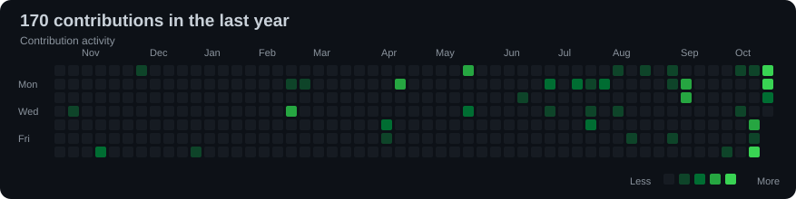
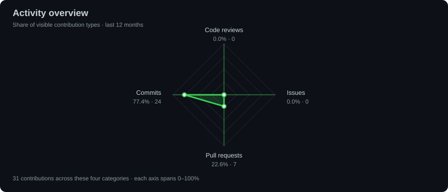
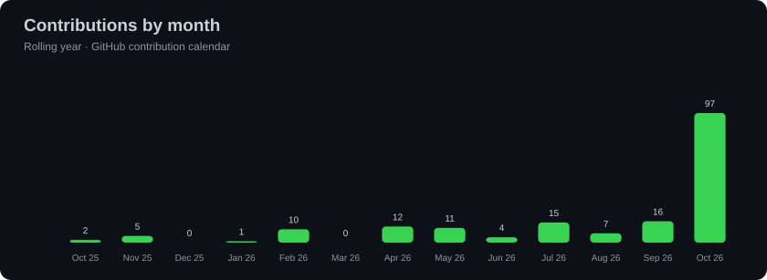

# 👋 Samael Pereira Simões

### Senior Full-Stack Software Engineer | Software Architecture | Cloud & Distributed Systems

**Java · Spring Boot · Angular · React · TypeScript · AWS · Microservices**

---

## About me

I'm a **Senior Full-Stack Software Engineer** with **10+ years of experience** designing, building, integrating, modernizing, and maintaining enterprise software. My background includes mission-critical applications, legacy modernization, service-oriented architectures, web applications, and hybrid mobile solutions.

I have contributed to software projects across **healthcare, manufacturing, finance, logistics, production, and inventory management**. I enjoy translating complex business requirements into reliable, secure, maintainable systems.

- 🎓 Degrees in **Software Engineering** and **Systems Analysis and Development**.
- ☕ Back-end development using **Java (8/11/17/21/25), Spring Boot, Spring Security, Hibernate, REST APIs, and .NET**.
- 🖥️ Front-end and mobile solutions using **Angular, React, TypeScript, JavaScript, and Ionic**.
- ☁️ Experience with **AWS, Docker, Terraform, GitHub Actions, and CI/CD**.
- 🔄 Distributed systems and messaging with **Kafka and ActiveMQ**, plus identity and access management with **Keycloak**.
- 🗃️ Relational database design and optimization using **PostgreSQL, Oracle, SQL Server, and MySQL**.
- 🧪 Automated testing, performance troubleshooting, clean code, SOLID principles, and long-term maintainability.
- 🌎 Interested in software engineering collaborations and opportunities in Brazil and abroad.

### What I work on

| Engineering area | Focus |
| --- | --- |
| **Back-end engineering** | Business logic, secure APIs, integration patterns, and modernization |
| **Front-end engineering** | Responsive SPAs, reusable components, client-side architecture, and API integration |
| **Software architecture** | Microservices, modular architecture, reliability, and maintainable design |
| **Data & persistence** | Data modeling, SQL performance, consistency, and transaction handling |
| **Cloud & delivery** | AWS infrastructure, containers, IaC, pipelines, and deployments |
| **Engineering quality** | Test automation, code reviews, incident investigation, and observability |

### How I approach software engineering

I favor **clear trade-offs, pragmatic architecture, maintainable code, secure integrations, and measurable improvements**. I believe strong software engineering is about solving the right problem and helping teams sustain their solutions over time.

## 🧰 Tech stack

### Languages

      

### Back-end / Integration

       

### Front-end / Mobile

    

### Databases

   

### Cloud, DevOps & Testing

         

---

## GitHub activity

Charts are generated daily from the GitHub API. Private and corporate contributions may not be fully represented.

### Contribution calendar

### Activity overview

### Monthly activity

### Commit history

The activity chart shows each category's share of the four contribution types. It is inspired by GitHub's Activity Overview; its counts may differ from the native profile widget.

[Explore full GitHub activity →](https://github.com/samaelsimoes?tab=overview)

---

## Public projects

| Project | Description | Source |
| --- | --- | --- |
| **Customer Manager — Web** | Customer management web application | [Repository](https://github.com/samaelsimoes/GerenciadorDeClientes-Web) |
| **Project Management — Android** | Android project management app | [Repository](https://github.com/samaelsimoes/Project-management-Android) |
| **QR Code Generator — Vue.js** | Web QR code generator | [Repository](https://github.com/samaelsimoes/QrCode-Generator-Vue.js) |
| **Financial Control** | Financial management project | [Repository](https://github.com/samaelsimoes/Financial-control) |
| **Node.js + JSON Files** | JSON file operations with Node.js | [Repository](https://github.com/samaelsimoes/activity-nodejs-with-json-files) |

[Explore all repositories →](https://github.com/samaelsimoes?tab=repositories)

---

### Let's connect!

**[Portfolio](https://samaelsimoes.github.io/)** · **[LinkedIn](https://www.linkedin.com/in/samaelsimoes/)** · **[Email](mailto:samael.simoes@gmail.com)** · **[GitHub](https://github.com/samaelsimoes)**

*Great software combines engineering, collaboration, and focus on the right problem.*

