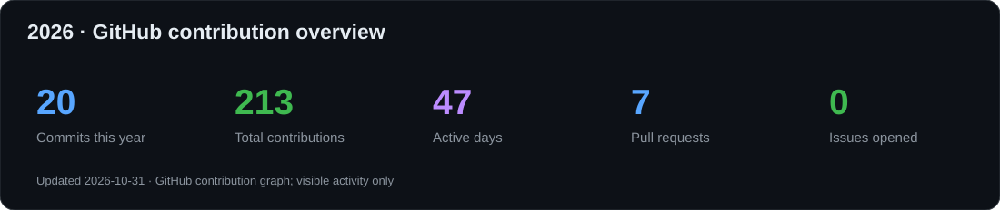
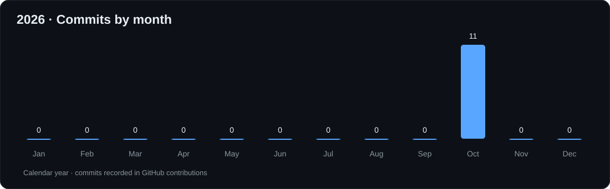
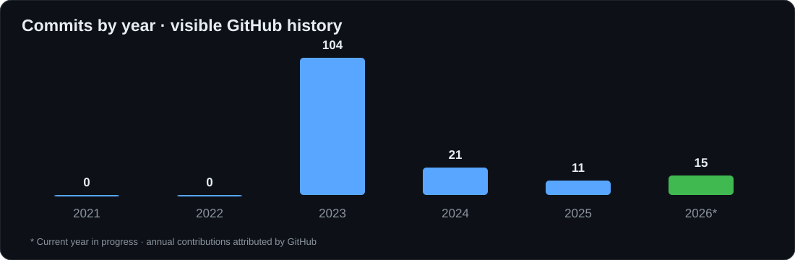

# Hello, I'm Samael Pereira Simões 👋

### Senior Full-Stack Software Engineer · Software Architecture · Founder & CEO

**10+ years building, modernizing and integrating enterprise software.**

Java & Spring Boot · Angular & React · Distributed Systems · AWS · Secure Integrations

---

## 🚀 About Me

I'm a **Senior Full-Stack Software Engineer** with more than **10 years of professional experience** delivering software solutions for **banking, healthcare, industrial operations, and logistics**.

My focus is on **software architecture, enterprise Java, modern front-end engineering, system integrations, reliability, and performance**. I work across the entire software lifecycle—from understanding business requirements and designing APIs to implementing scalable services, maintaining production applications, and improving developer workflows.

I'm also the **Founder & CEO of [SPS Digital Solutions Technology](https://spstechnology.com.br/)**, a software company focused on custom applications, consulting, integrations, and outsourcing.

- 🏗️ **Architecture:** Clean Architecture, SOLID, design patterns, microservices and distributed systems
- 🔄 **Modernization:** legacy applications, refactoring, API evolution and system interoperability
- 🔐 **Security:** authentication, authorization, IAM and secure enterprise integration
- ☁️ **Cloud & delivery:** AWS, containers, infrastructure automation and CI/CD
- 🧪 **Engineering quality:** automated testing, maintainable code, technical reviews and performance
- 🎓 **Education:** Software Engineering and Systems Analysis & Development degrees
- 🌍 **Collaboration:** Brazil-based; interested in international software engineering partnerships

---

## 📊 GitHub Analytics · Live Dashboard

### Commits this year · active days · contributions · PRs · issues

### Commits per month · current year

### Commit history · year by year

### GitHub statistics

### Daily contributions · last 12 months

### Current streak · longest streak · total contributions

### Contribution activity graph

### Contribution overview · languages by repo and commits

### Coding hours · additional stats

---

## 🧰 Technologies & Tools

### Back-End & Enterprise Java

### Front-End & Mobile

### Databases, Messaging & Integration

### Cloud, DevOps, Security & Testing

**Engineering practices:** `Clean Architecture` · `SOLID` · `Microservices` · `Event-Driven Design` · `REST APIs` · `Security by Design` · `CI/CD` · `Testing` · `Code Reviews` · `Performance Optimization`

---

## 💼 What I Build

| Area | Focus |
| --- | --- |
| 🏦 **Banking & Enterprise** | Reliable APIs, secure transactions and complex business workflows |
| 🏥 **Healthcare** | Integration, reporting, monitoring and business-critical applications |
| 🏭 **Industrial & Logistics** | Operational platforms, integration flows and process automation |
| 🏗️ **Software Architecture** | Service boundaries, clean code, distributed communication and maintainability |
| 🔄 **Legacy Modernization** | Gradual migrations, refactoring and integration with established systems |
| ☁️ **Cloud & DevOps** | AWS services, deployments, CI/CD, environments and observability |

---

## 🏢 Founder · SPS Digital Solutions Technology

At **[SPS Digital Solutions Technology](https://spstechnology.com.br/)**, I work on **custom software development, web platforms, business integrations, outsourcing, consulting and modernization** for organizations that need technology aligned with real operational goals.

---

## 🌐 Connect With Me

**Engineering with purpose. Architecture with clarity. Software built to last.**

