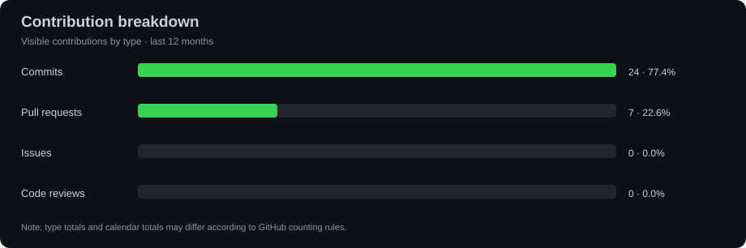

# 👋 Samael Pereira Simões

### Senior Full-Stack Software Engineer | Software Architecture | Cloud & Distributed Systems

**Java · Spring Boot · Angular · React · TypeScript · AWS · Microservices**

**🇧🇷 Português** · **🇺🇸 English**

[**🇧🇷 Ler em português**](#-sobre-mim) · [**🇺🇸 Read in English**](#-about-me-english)

---

## 🇧🇷 Sobre mim

Sou **Engenheiro de Software e Desenvolvedor Full Stack Sênior**, com **mais de 10 anos de experiência** na construção, evolução, integração e sustentação de sistemas empresariais. Trabalho com aplicações de missão crítica, modernização de sistemas legados, arquitetura de serviços e soluções web e mobile.

Atuei em projetos ligados a **saúde, indústria, finanças, logística, produção e gestão de estoques**, conectando decisões de engenharia às necessidades reais do negócio.

- 🎓 Formação em **Engenharia de Software** e **Análise e Desenvolvimento de Sistemas**.
- 🧱 Arquitetura de software, design de APIs, padrões de projeto, **SOLID** e **Clean Architecture**.
- ☕ **Java (8, 11, 17, 21 e 25)**, Spring Boot, ecossistema Spring e integrações REST.
- 🖥️ **Angular, React, TypeScript, JavaScript** e desenvolvimento mobile híbrido com **Ionic**.
- ☁️ Cloud e entrega contínua: **AWS, Docker, Terraform, GitHub Actions e CI/CD**.
- 🔄 Sistemas distribuídos, mensageria com **Kafka e ActiveMQ**, autenticação com **Keycloak**.
- 📊 Bancos relacionais, otimização de SQL, transações, consistência de dados e observabilidade.
- 🌍 Aberto a oportunidades de colaboração, engenharia de software e projetos nacionais ou internacionais.

### 💼 O que entrego

| Área | Experiência e contribuição |
| --- | --- |
| **Back-end** | APIs REST, regras de negócio complexas, integrações, segurança e modernização de legados |
| **Front-end** | SPAs, componentes reutilizáveis, interfaces responsivas e integração com múltiplos serviços |
| **Arquitetura** | Microsserviços, arquitetura em camadas, desacoplamento e evolução sustentável |
| **Dados** | PostgreSQL, Oracle, SQL Server e MySQL; modelagem, consultas, transações e desempenho |
| **Cloud & DevOps** | AWS, containers, IaC, versionamento, pipelines e implantação |
| **Qualidade** | Testes automatizados, revisão de código, diagnóstico de falhas e manutenibilidade |

### 🧭 Segmentos com experiência

`Saúde e sistemas hospitalares` · `Indústria e produção` · `Logística` · `Finanças` · `Estoque e suprimentos` · `Sistemas corporativos`

---

## 🧰 Tech stack / Tecnologias

### Linguagens / Languages

      

### Back-end / Integration

       

### Front-end / Mobile

    

### Databases / Bancos de dados

   

### Cloud, DevOps & Testing

         

---

## 📊 GitHub Analytics / Estatísticas

> **PT:** Estes gráficos são atualizados pelo GitHub Actions e representam as contribuições que a API do GitHub disponibiliza ao workflow. Contribuições privadas ou corporativas podem não estar integralmente contabilizadas.  
> **EN:** These charts are updated by GitHub Actions and reflect contributions visible to the workflow through the GitHub API. Private and corporate work may not be fully represented.

### 🟩 Contribution Calendar / Calendário de contribuições

### 📅 Monthly Activity / Atividade mensal

### 🧩 Contribution Types / Tipos de contribuição

> **Importante / Important:** O bloco nativo **Activity Overview** (repositórios e porcentagens da imagem do GitHub) não pode ser incorporado como componente interativo oficial ao README. O gráfico acima apresenta um resumo equivalente, calculado a partir da API; os totais podem divergir dos mostrados na página de perfil.

---

## 🚀 Projetos públicos / Public projects

| Projeto / Project | Descrição / Description | Código / Source |
| --- | --- | --- |
| **Gerenciador de Clientes — Web** | Aplicação de gerenciamento de clientes / Customer management web application | [Repositório](https://github.com/samaelsimoes/GerenciadorDeClientes-Web) |
| **Project Management — Android** | Gerenciamento de projetos em Android / Android project management app | [Repositório](https://github.com/samaelsimoes/Project-management-Android) |
| **QR Code Generator — Vue.js** | Gerador de QR Codes / Web QR code generator | [Repositório](https://github.com/samaelsimoes/QrCode-Generator-Vue.js) |
| **Financial Control** | Controle financeiro / Financial management project | [Repositório](https://github.com/samaelsimoes/Financial-control) |
| **Node.js + JSON Files** | Prática com arquivos JSON / JSON file operations with Node.js | [Repositório](https://github.com/samaelsimoes/activity-nodejs-with-json-files) |

**➡️ [Ver todos os repositórios / Explore all repositories](https://github.com/samaelsimoes?tab=repositories)**

---

## 🧠 Princípios de engenharia / Engineering principles

- **Sustentabilidade / Maintainability:** código legível, coeso e preparado para evoluir.
- **Arquitetura pragmática / Pragmatic architecture:** soluções proporcionais aos desafios e restrições reais.
- **Segurança / Security:** atenção a autenticação, autorização, proteção de dados e integrações.
- **Qualidade / Quality:** testes, revisão de código, rastreabilidade e resolução de falhas.
- **Entrega de valor / Delivery:** foco em resultados para usuários, equipes e negócios.
- **Colaboração / Collaboration:** documentação útil, comunicação técnica e compartilhamento de conhecimento.

---

## 🇺🇸 About me (English)

I'm a **Senior Full-Stack Software Engineer** with **10+ years of experience** designing, building, integrating, modernizing, and maintaining enterprise software. My background includes mission-critical applications, legacy modernization, service-oriented architectures, web applications, and hybrid mobile solutions.

I have contributed to software projects across **healthcare, manufacturing, finance, logistics, production, and inventory management**. I enjoy translating complex business requirements into reliable, secure, maintainable systems.

- 🎓 Degrees in **Software Engineering** and **Systems Analysis and Development**.
- ☕ Back-end development using **Java (8/11/17/21/25), Spring Boot, Spring Security, Hibernate, REST APIs, and .NET**.
- 🖥️ Front-end and mobile solutions using **Angular, React, TypeScript, JavaScript, and Ionic**.
- ☁️ Experience with **AWS, Docker, Terraform, GitHub Actions, and CI/CD**.
- 🔄 Distributed systems and messaging with **Kafka and ActiveMQ**, plus identity and access management with **Keycloak**.
- 🗃️ Relational database design and optimization using **PostgreSQL, Oracle, SQL Server, and MySQL**.
- 🧪 Automated testing, performance troubleshooting, clean code, SOLID principles, and long-term maintainability.
- 🌎 Interested in software engineering collaborations and opportunities in Brazil and abroad.

### What I work on

| Engineering area | Focus |
| --- | --- |
| **Back-end engineering** | Business logic, secure APIs, integration patterns, and modernization |
| **Front-end engineering** | Responsive SPAs, reusable components, client-side architecture, and API integration |
| **Software architecture** | Microservices, modular architecture, reliability, and maintainable design |
| **Data & persistence** | Data modeling, SQL performance, consistency, and transaction handling |
| **Cloud & delivery** | AWS infrastructure, containers, IaC, pipelines, and deployments |
| **Engineering quality** | Test automation, code reviews, incident investigation, and observability |

### How I approach software engineering

I favor **clear trade-offs, pragmatic architecture, maintainable code, secure integrations, and measurable improvements**. I believe strong software engineering is about solving the right problem and helping teams sustain their solutions over time.

**📌 [View technical stack](#-tech-stack--tecnologias) · [Explore public projects](#-projetos-públicos--public-projects) · [See GitHub analytics](#-github-analytics--estatísticas)**

---

### 🤝 Vamos conversar? / Let's connect!

**[Portfólio / Portfolio](https://samaelsimoes.github.io/)** · **[LinkedIn](https://www.linkedin.com/in/samaelsimoes/)** · **[E-mail / Email](mailto:samael.simoes@gmail.com)** · **[GitHub](https://github.com/samaelsimoes)**

*"Software de qualidade combina engenharia, colaboração e foco no problema certo."*  
*"Great software combines engineering, collaboration, and focus on the right problem."*

