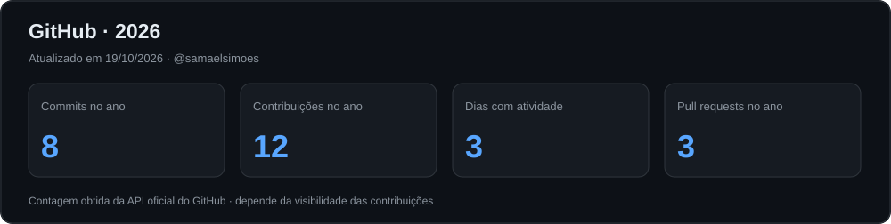
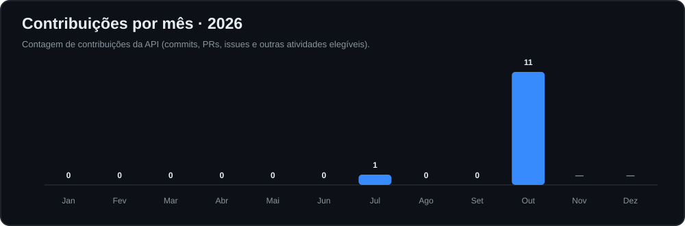
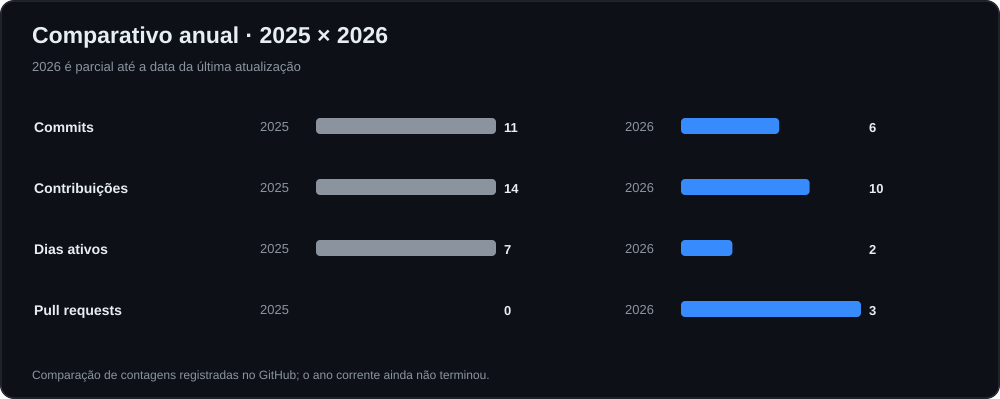
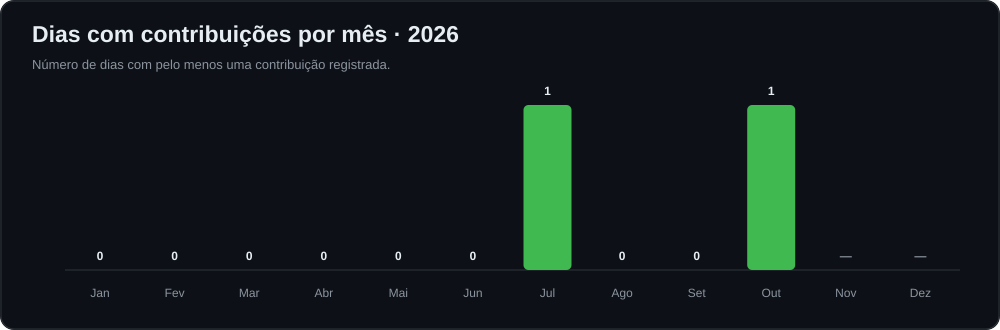

# Olá, eu sou Samael Pereira Simões 👋

### Senior Full-Stack Software Engineer · Software Architecture · Cloud & Distributed Systems

**Java & Spring Boot · Angular & React · TypeScript · AWS · Microservices**

Desenvolvendo software corporativo, integrações e produtos digitais há **mais de 10 anos**.

---

## 👨‍💻 Sobre mim

Sou engenheiro de software e desenvolvedor **Full Stack Sênior**, com experiência em análise, arquitetura, desenvolvimento, integração, implantação e sustentação de sistemas empresariais. Atuo com aplicações de missão crítica, modernização de sistemas legados e integração entre serviços em contextos como **indústria, finanças, saúde e logística**.

- 🎓 Formação em **Engenharia de Software** e **Análise e Desenvolvimento de Sistemas**.
- 🧱 Foco em **Clean Architecture**, **SOLID**, boas práticas, testabilidade e manutenção de longo prazo.
- ☕ Experiência com **Java 8/11/17/21/25**, **Spring Boot**, APIs REST e integração de sistemas.
- 🖥️ Experiência com **Angular**, **React**, **TypeScript** e aplicações híbridas com **Ionic**.
- ☁️ Vivência com **AWS**, containers, automação e pipelines de entrega.
- 🔄 Atuação em microsserviços, mensageria e bancos de dados relacionais.
- 🤝 Interesse em colaboração técnica, revisão de código, mentoria e resolução de problemas complexos.
- 🌎 Interesse em oportunidades e projetos de engenharia de software no Brasil e internacionalmente.

## 🧰 Tecnologias e ferramentas

### Linguagens

### Back-end & integrações

### Front-end & mobile

### Bancos de dados

### Cloud, DevOps, testes & ferramentas

## 🧠 Áreas de atuação

| Engenharia de software | Arquitetura & integração | Qualidade & operação |
| --- | --- | --- |
| Sistemas corporativos | Microsserviços e APIs REST | Testes automatizados |
| Modernização de legados | Mensageria e eventos | CI/CD e versionamento |
| Aplicações web e mobile | Autenticação e autorização | Observabilidade e diagnóstico |
| Modelagem de dados | Integração entre plataformas | Performance e manutenção |

---

## 📊 GitHub em números

> As métricas abaixo refletem a atividade **registrada no GitHub**, não todos os commits de repositórios corporativos, locais ou privados. Cards externos podem sofrer limitações temporárias; os gráficos locais são gerados automaticamente pelo workflow deste repositório.

### 🗓️ Calendário de contribuições

### 📈 Linguagens nos repositórios e contribuições

> **Nota:** o ranking de linguagens considera os repositórios analisados pelo provedor; não representa necessariamente a senioridade ou o uso em projetos profissionais privados.

---

## 🚀 Projetos públicos

Alguns repositórios do meu GitHub. Confira a descrição e a atividade mais recente em cada link.

| Projeto | Descrição | Repositório |
| --- | --- | --- |
| **Gerenciador de Clientes — Web** | Aplicação web para gerenciamento de clientes. | [Ver código](https://github.com/samaelsimoes/GerenciadorDeClientes-Web) |
| **Project Management — Android** | Projeto Android voltado ao gerenciamento de projetos. | [Ver código](https://github.com/samaelsimoes/Project-management-Android) |
| **QR Code Generator — Vue.js** | Gerador de QR Code com interface web. | [Ver código](https://github.com/samaelsimoes/QrCode-Generator-Vue.js) |
| **Financial Control** | Projeto de controle financeiro. | [Ver código](https://github.com/samaelsimoes/Financial-control) |
| **Node.js + JSON Files** | Exercícios e operações com arquivos JSON usando Node.js. | [Ver código](https://github.com/samaelsimoes/activity-nodejs-with-json-files) |

➡️ **[Explorar todos os repositórios](https://github.com/samaelsimoes?tab=repositories)**

## 🎯 Princípios que guiam meu trabalho

- **Código sustentável:** soluções legíveis, testáveis e com responsabilidade bem definida.
- **Arquitetura adequada ao problema:** decisões técnicas que equilibram simplicidade, evolução e custo.
- **Segurança desde o início:** atenção a dados, autenticação, autorização e integrações.
- **Entrega de valor:** tecnologia aplicada a necessidades reais de produto e negócio.
- **Melhoria contínua:** aprendizado constante, colaboração e compartilhamento de conhecimento.

## 🌐 Portfólio e contato

### Vamos construir soluções de impacto?

**[Portfólio profissional](https://samaelsimoes.github.io/)** · **[LinkedIn](https://www.linkedin.com/in/samaelsimoes/)** · **[E-mail](mailto:samael.simoes@gmail.com)** · **[Repositórios](https://github.com/samaelsimoes?tab=repositories)**

*“Software de qualidade combina engenharia, colaboração e foco no problema certo.”*

